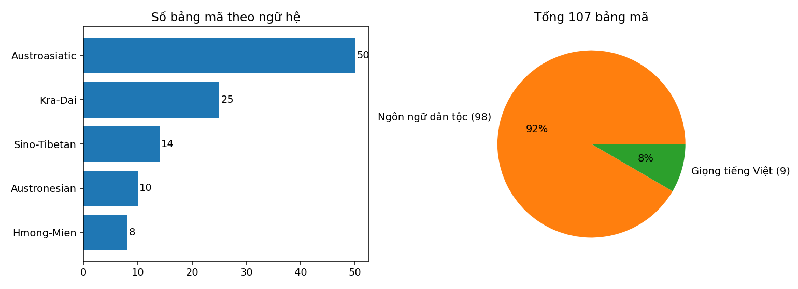
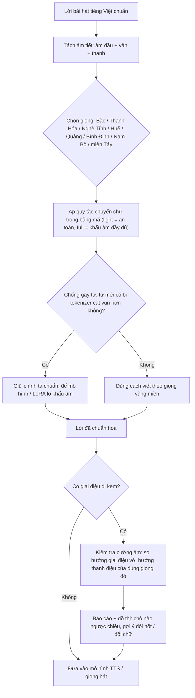
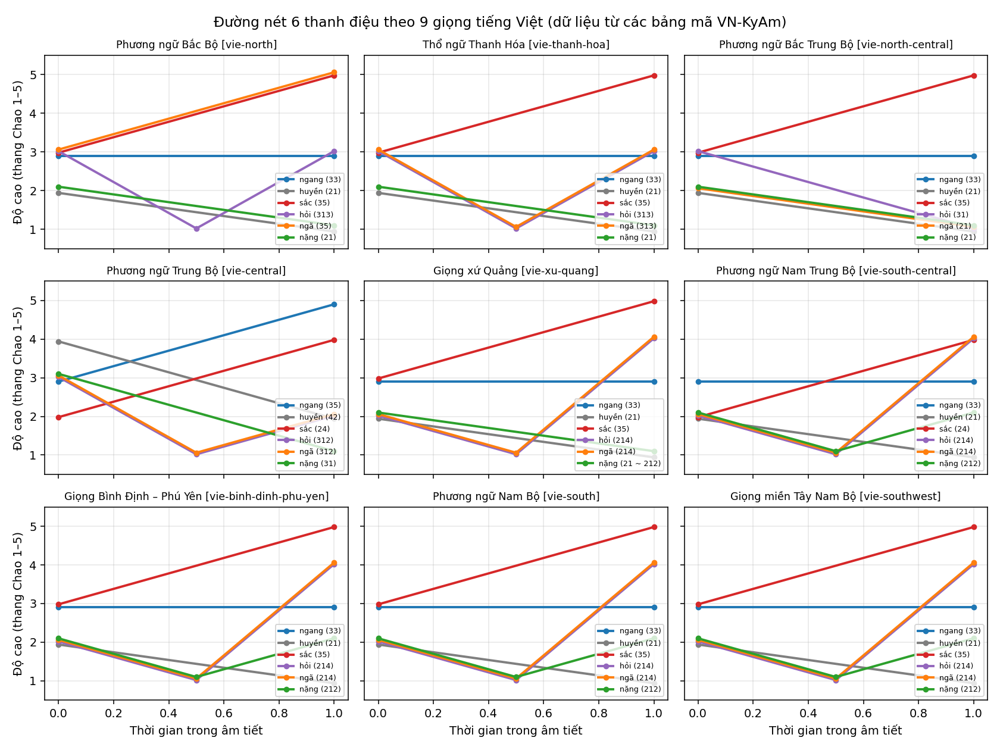
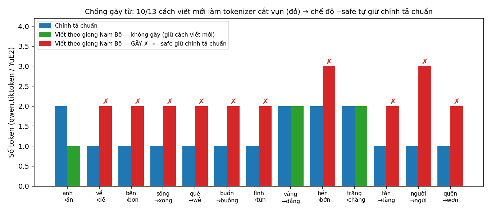
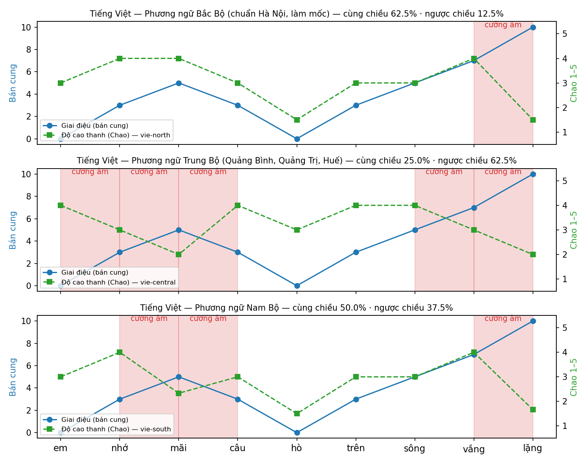
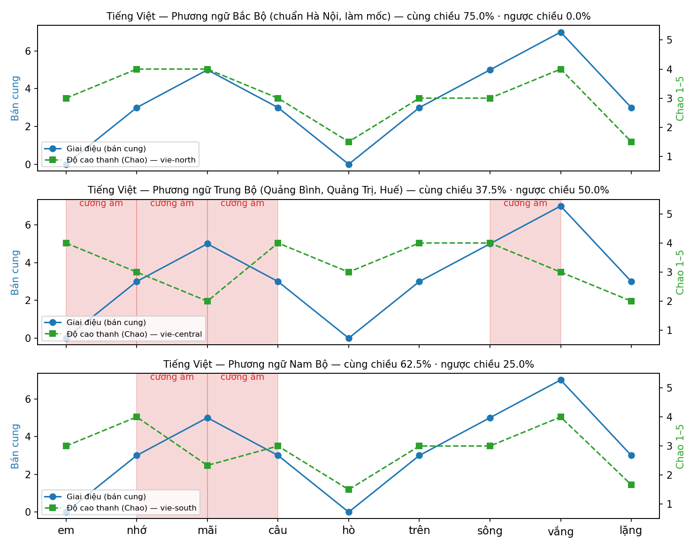

# VN-KyAm — Bảng Mã Ký Âm Mở Việt Nam
### Open, machine-readable phonetic codebooks for Vietnamese regional varieties and the languages of Viet Nam's 53 ethnic minorities

**Giấy phép: CC0 1.0 Universal (Public Domain Dedication).** Toàn bộ dữ liệu, schema, công cụ và tài liệu trong repo này
được hiến tặng vào phạm vi công cộng. Bất kỳ ai cũng được sao chép, sửa đổi, phân phối và dùng cho mục đích thương mại
mà không cần xin phép hay trả phí. Xem [LICENSE](LICENSE).

▶️ **Video demo:** https://youtu.be/jJ50J8sL5po

> **Tuyên bố công bố (Publication statement).** Repo này công bố công khai các quy tắc ký âm giọng vùng miền tiếng Việt và
> các bảng chữ–âm của ngôn ngữ dân tộc thiểu số Việt Nam, để đưa chúng vào phạm vi công cộng và không cá nhân hay tổ chức nào
> độc quyền hóa được. Tiếng nói, phương ngữ và chữ viết là tài sản chung của các cộng đồng. Bộ mã này chỉ là một cách mô tả
> kỹ thuật, không xác lập quyền sở hữu nào đối với ngôn ngữ.
> Mốc thời gian: lịch sử Git, các tag phát hành, `CHANGELOG.md` và dấu vân tay nội dung `dist/SHA256SUMS`.

---

## Mục lục
1. [Có gì bên trong](#có-gì-bên-trong)
2. [Tool xử lý như thế nào — giải thích bằng đồ thị](#tool-xử-lý-như-thế-nào--giải-thích-bằng-đồ-thị)
3. [Dùng nhanh](#dùng-nhanh)
4. [Danh sách ngôn ngữ và giọng](#danh-sách-ngôn-ngữ-và-giọng)
5. [Mức độ tin cậy](#mức-độ-tin-cậy--xin-đọc-trước-khi-dùng)
6. [Lời cảm ơn](#lời-cảm-ơn)
7. [Trích dẫn và tài liệu tham khảo](#trích-dẫn-và-tài-liệu-tham-khảo)

---

## Có gì bên trong



**107 bảng mã**: 9 giọng tiếng Việt và 98 ngôn ngữ / biến thể thuộc **đủ 53 dân tộc thiểu số**.

| Thành phần | Mô tả |
|---|---|
| `codebooks/vietnamese/` | 9 giọng tiếng Việt |
| `codebooks/minority/` | 98 bảng mã ngôn ngữ dân tộc (mỗi dân tộc có ít nhất 1 bảng; các dân tộc có nhiều ngôn ngữ như Thái, H'Mông, Xơ Đăng… có thêm bảng riêng cho từng ngôn ngữ) |
| `schema/codebook.schema.json` | JSON Schema chung |
| `dist/` | Bản gộp: `index.json`, `vn_kyam_all.json`, CSV (tương ứng âm, quy tắc chuyển chữ, chữ–IPA, thanh điệu, xấp xỉ Quốc ngữ), `SHA256SUMS` |
| `tools/apply_respelling.py` | Chuyển lời tiếng Việt chuẩn sang cách viết theo giọng vùng miền; `--safe` chống gãy từ |
| `tools/tokenizer_check.py` | Thống kê từ nào bị tokenizer cắt vụn sau khi chuyển chữ |
| `tools/cuong_am_check.py` | **Mới:** phát hiện cưỡng âm (lệch thanh điệu – giai điệu) theo từng giọng vùng miền, có vẽ đồ thị |
| `tools/make_figures.py` | Tạo lại toàn bộ hình trong `docs/img/` |
| `tools/generate_codebooks.py` | Pipeline tạo / mở rộng bảng mã bằng LLM có tra cứu web và phản biện chéo |
| `tools/build_release.py` | Kiểm schema và đóng gói `dist/` |
| `SKILL.md` | Hướng dẫn cho AI agent |
| `paper/` | Báo cáo kỹ thuật ([v0.2.0](paper/VN-KyAm_technical_report_v0.2.0.md)) |

Mỗi bảng mã gồm:
- Mã ISO 639-3 / Glottocode, ngữ hệ, chữ viết (kèm khối Unicode).
- Âm đầu, nguyên âm, âm cuối (chữ → IPA).
- Thanh điệu (số Chao) hoặc âm vực.
- Với giọng tiếng Việt: **tương ứng âm so với chuẩn** và **quy tắc chuyển chữ máy chạy được**.
- Với ngôn ngữ dân tộc: **cách viết xấp xỉ bằng chữ Quốc ngữ**, cho mô hình TTS / giọng hát chỉ biết tiếng Việt.
- Từ vựng địa phương, âm nhạc dân gian, gợi ý cho ML, nguồn tham khảo và trạng thái thẩm định.

---

## Tool xử lý như thế nào — giải thích bằng đồ thị

### Toàn bộ quy trình



### 1. Giọng vùng miền khác nhau ở đâu? — đường nét thanh điệu



Mỗi ô là một giọng; mỗi đường là một thanh, vẽ theo số Chao lấy từ bảng mã (1 = thấp nhất, 5 = cao nhất). Ví dụ:
- Giọng Bắc có 6 thanh riêng biệt. Thanh ngã đi lên cao.
- Từ Huế trở vào, **hỏi và ngã nhập làm một** (đường tím và cam trùng nhau). Đây là lý do `cũ` được viết thành `củ` theo giọng Nam.
- Nghệ Tĩnh nhập **ngã với nặng**.
- Giọng Huế có thanh ngang cao và thanh sắc xuất phát thấp, nên cùng một giai điệu có thể hợp với giọng Hà Nội nhưng
  "trái" với giọng Huế (xem mục 3).

*(Số Chao của các giọng trừ Nam Bộ là bản nháp do AI soạn, có chỗ các nguồn chưa thống nhất, ví dụ thanh sắc ở Nam Trung Bộ
được ghi `24` trong khi giọng xứ Quảng ghi `35`. Rất mong người bản xứ góp ý.)*

### 2. Chống gãy từ (tokenizer cắt vụn chữ)



Mô hình AI không đọc từng chữ cái mà đọc **token**. Khi viết `về` thành `dề` cho đúng giọng Nam, tokenizer của mô hình
(ở đây là `qwen.tiktoken` của YuE2) có thể tách một từ quen thuộc (1 token) thành 2–3 mảnh lạ. Mô hình hát mảnh lạ thì dễ
méo chữ, gọi là **gãy từ**.

- Cột xanh dương là chính tả chuẩn, cột bên cạnh là cách viết theo giọng Nam Bộ.
- **Đỏ ✗** là trường hợp bị cắt vụn hơn. Chế độ `--safe` **tự giữ lại chính tả chuẩn** cho những từ này và để mô hình đã
  fine-tune theo giọng lo phần khẩu âm.
- **Xanh lá** là trường hợp không gãy (thậm chí gọn hơn, như `anh → ăn`), nên giữ cách viết mới.
- Trong câu mẫu, 10/13 cách viết đầy đủ bị gãy. Vì vậy với mô hình đã fine-tune nên dùng `--level light` hoặc `--safe`.

### 3. Phát hiện cưỡng âm theo từng giọng

Khi hát tiếng Việt, chữ nghe rõ khi **giai điệu đi cùng chiều với thanh điệu** từ chữ này sang chữ kế tiếp. Ví dụ, từ một
chữ thanh ngang lên một chữ thanh sắc thì nốt nhạc cũng nên đi lên. Nếu giai điệu đi **ngược chiều** thanh điệu (chữ thanh
nặng lại đặt trên nốt vọt lên cao), người nghe dễ nghe thành chữ khác: đó là **cưỡng âm**. Cách đo theo hướng chuyển tiếp
dựa trên nghiên cứu của Kirby & Ladd (2016). Họ thấy nhạc pop Việt ưu tiên chuyển động cùng chiều và tránh chuyển động ngược
chiều.

Điểm mới của VN-KyAm là độ cao từng thanh được lấy **theo đúng giọng** trong bảng mã. Vì vậy cùng một câu nhạc, giọng Hà
Nội có thể ổn mà giọng Huế hay Nam Bộ lại bị cưỡng âm.

| Trước khi sửa: chữ "lặng" (thanh nặng) đặt trên nốt D5 vọt lên | Sau khi sửa: hạ "lặng" xuống G4 |
|---|---|
|  |  |

Vùng tô đỏ là chỗ cưỡng âm.
- Hạ "lặng" xuống G4 thì hết cưỡng âm "vắng → lặng" ở cả 3 giọng, và giọng Hà Nội không còn cảnh báo nào.
- Giọng Nam Bộ vẫn còn 2 chỗ (nhớ → mãi, mãi → câu), vì ở giọng Nam thanh ngã đọc như hỏi (trũng xuống), trong khi giai
  điệu lại đi lên.
- Giọng Huế còn nhiều chỗ hơn, vì thanh ngang Huế cao còn thanh sắc xuất phát thấp. Câu nhạc này được viết "theo tai" giọng
  Bắc, nên muốn hát chuẩn giọng Huế phải sửa thêm.

> Đây là công cụ gợi ý dựa trên quy tắc, giúp nhạc sĩ và người làm AI rà nhanh, **không thay cho tai của nhạc sĩ**.
> Trong nhạc thật vẫn có nhiều chỗ chuyển động ngang (oblique) hay ngược chiều được chấp nhận.

---

## Dùng nhanh

```bash
# 1) Chuyển lời sang giọng Nam Bộ — mức an toàn cho tokenizer
python3 tools/apply_respelling.py --codebook codebooks/vietnamese/vie-south.json --level light "Trăng ơi buồn nhớ ai, cũ kỹ say tay"

# 2) Khẩu âm đầy đủ nhưng chống gãy từ (tự giữ chính tả chuẩn cho từ bị cắt vụn)
python3 tools/apply_respelling.py --codebook codebooks/vietnamese/vie-central.json --level full --include-optional --safe < loi.txt

# 3) Thống kê gãy từ (mặc định qwen.tiktoken của YuE2-3B; hoặc --hf <tên tokenizer>)
python3 tools/tokenizer_check.py --codebook codebooks/vietnamese/vie-south.json --level full --text-file loi.txt

# 4) Kiểm tra cưỡng âm, so sánh 3 giọng và vẽ đồ thị
python3 tools/cuong_am_check.py \
  --codebook codebooks/vietnamese/vie-north.json \
  --codebook codebooks/vietnamese/vie-central.json \
  --codebook codebooks/vietnamese/vie-south.json \
  --plot cuong_am.png "em/E4 nhớ/G4 mãi/A4 câu/G4 hò/E4 trên/G4 sông/A4 vắng/B4 lặng/D5"
```

```python
import json
idx = json.load(open("dist/index.json"))
tay = json.load(open("codebooks/minority/tay.json"))
print(tay["phonology"]["tones"])                    # 6 thanh tiếng Tày
print(tay["ml_hints"]["quoc_ngu_approximation"])    # cách viết xấp xỉ bằng chữ Quốc ngữ
```

---

## Danh sách ngôn ngữ và giọng

### Giọng tiếng Việt (9)

| Giọng | id | Ghi chú |
|---|---|---|
| Phương ngữ Bắc Bộ (chuẩn Hà Nội, làm mốc) | `vie-north` |  |
| Thổ ngữ Thanh Hóa | `vie-thanh-hoa` | mới ở v0.2.0 |
| Phương ngữ Bắc Trung Bộ (Thanh Hóa, Nghệ An, Hà Tĩnh) | `vie-north-central` |  |
| Phương ngữ Trung Bộ (Quảng Bình, Quảng Trị, Huế) | `vie-central` |  |
| Giọng xứ Quảng (Đà Nẵng, Quảng Nam, Quảng Ngãi) | `vie-xu-quang` | mới ở v0.2.0 |
| Phương ngữ Nam Trung Bộ (Đà Nẵng, Quảng Nam, Quảng Ngãi, Bình Định, Phú Yên) | `vie-south-central` |  |
| Giọng Bình Định – Phú Yên | `vie-binh-dinh-phu-yen` | mới ở v0.2.0 |
| Phương ngữ Nam Bộ | `vie-south` | bản tham chiếu do con người soạn |
| Giọng miền Tây Nam Bộ (Đồng bằng sông Cửu Long) | `vie-southwest` | mới ở v0.2.0 |

### Ngôn ngữ của 53 dân tộc thiểu số (98 bảng mã)

| Dân tộc | Bảng mã: tên (id · ISO 639-3) |
|---|---|
| Ba Na | Ba Na (`ba-na` · bdq); Rơ Ngao (`ba-na-ren` · ren) |
| Bru - Vân Kiều | Bru - Vân Kiều (`bru-van-kieu` · bru); Khùa (`bru-van-kieu-xhv` · xhv) |
| Brâu | Brâu (`brau` · brb) |
| Bố Y | Bố Y (`bo-y` · pcc) |
| Chu Ru | Chu Ru (`chu-ru` · cje) |
| Chăm | Chăm (`cham` · cjm); Chăm Tây (Chăm Nam Bộ) (`cham-cja` · cja); Haroi (Chăm H'roi) (`cham-hro` · hro) |
| Chơ Ro | Chơ Ro (`cho-ro` · crw) |
| Chứt | Chứt (`chut` · scb); Arem (`chut-aem` · aem); Mã Liềng (`chut-pkt` · pkt) |
| Co | Co (`co` · cua) |
| Cơ Ho | Cơ Ho (`co-ho` · kpm) |
| Cơ Tu | Cơ Tu (`co-tu` · ktv); Phương (Cơ Tu Phương) (`co-tu-phg` · phg) |
| Cống | Cống (`cong` · cnc) |
| Cờ Lao | Cờ Lao (`co-lao` · giw); Cờ Lao Xanh (`co-lao-giq` · giq); Cờ Lao Đỏ (`co-lao-gir` · gir) |
| Dao | Dao (Ưu Miền / Dìu Miền) (`dao` · ium); Kim Mun (Dao Làn Tẻn / Thanh Y / Quần Trắng) (`dao-mji` · mji) |
| Gia Rai | Gia Rai (`gia-rai` · jra) |
| Giáy | Giáy (`giay` · pcc) |
| Giẻ Triêng | Giẻ Triêng (`gie-trieng` · jeh); Triêng (`gie-trieng-stg` · stg); Ve (Talieng) (`gie-trieng-tdf` · tdf) |
| H'Mông | H'Mông (`hmong` · hnj); Hmong Don (`hmong-hmf` · hmf); Mông Đô (`hmong-hmv` · hmv); Mông Xanh (Hmong Shua) (`hmong-hmz` · hmz); Mông Trắng (Hmong Daw) (`hmong-mww` · mww) |
| Hoa | Hoa (`hoa` · yue); Hải Nam (`hoa-hnm` · hnm); Triều Châu (Tiều) (`hoa-nan` · nan) |
| Hrê | Hrê (`hre` · hre) |
| Hà Nhì | Hà Nhì (`ha-nhi` · hni) |
| Khmer | Khmer (`khmer` · khm) |
| Kháng | Kháng (`khang` · kjm) |
| Khơ Mú | Khơ Mú (`kho-mu` · kjg) |
| La Chí | La Chí (`la-chi` · lbt); La Chí Trắng (`la-chi-lwh` · lwh) |
| La Ha | La Ha (`la-ha` · lha) |
| La Hủ | La Hủ (`la-hu` · lhu); La Hủ Sư (La Hủ Vàng) (`la-hu-lhi` · lhi); Khù Sung (La Hủ Na) (`la-hu-lkc` · lkc) |
| Lào | Lào (`lao` · lao) |
| Lô Lô | Lô Lô (`lo-lo` · nty) |
| Lự | Lự (`lu` · khb) |
| Mnông | Mnông (`mnong` · cmo); Mnông Đông (`mnong-mng` · mng); Mnông Nam (`mnong-mnn` · mnn) |
| Mường | Mường (`muong` · mtq); Nguồn (`muong-nuo` · nuo) |
| Mạ | Mạ (`ma` · cma) |
| Mảng | Mảng (`mang` · zng) |
| Ngái | Ngái (`ngai` · hak) |
| Nùng | Nùng (`nung` · nut); En (Nùng Vẻn) (`nung-enc` · enc); Nùng Dín (`nung-zhn` · zhn) |
| Phù Lá | Phù Lá (`phu-la` · phh); Laghuu (Xá Phó / Phù Lá Lão) (`phu-la-lgh` · lgh) |
| Pu Péo | Pu Péo (`pu-peo` · laq) |
| Pà Thẻn | Pà Thẻn (`pa-then` · pha) |
| Ra Glai | Ra Glai (`ra-glai` · rog); Raglai Nam (`ra-glai-rgs` · rgs); Raglai Các Gia (`ra-glai-roc` · roc) |
| Rơ Măm | Rơ Măm (`ro-mam` · rmx) |
| Si La | Si La (`si-la` · slt) |
| Sán Chay | Sán Chay (`san-chay` · mlc) |
| Sán Dìu | Sán Dìu (`san-diu` · yue) |
| Thái | Thái (`thai` · blt); Tày Hàng Tổng (Tày Mường) (`thai-thc` · tpo); Tai Thanh (Thái Thanh / Tày Nhài) (`thai-tmm` · tmm); Thái Trắng (Tày Đón) (`thai-twh` · twh); Tai Yo (Thái Quỳ Châu) (`thai-tyj` · tyj); Thái Đỏ (`thai-tyr` · tyr); Tày Tấc (`thai-tyt` · tyt) |
| Thổ | Thổ (`tho` · tou); Tày Poọng / Đan Lai – Ly Hà (Hung) (`tho-hnu` · hnu) |
| Tà Ôi | Tà Ôi (`ta-oi` · tth); Pa Cô (`ta-oi-pac` · pac) |
| Tày | Tày (`tay` · tyz); Pa Dí (`tay-pdi` · pdi); Thu Lao (`tay-tyl` · tyl) |
| Xinh Mun | Xinh Mun (`xinh-mun` · puo) |
| Xtiêng | Xtiêng (`stieng` · sti); Xtiêng Bù Đêh (`stieng-stt` · stt) |
| Xơ Đăng | Xơ Đăng (`xo-dang` · sed); Hà Lăng (`xo-dang-hal` · hal); Ca Dong (`xo-dang-kxy` · kxy); Mơ Nâm (`xo-dang-moo` · moo); Tơ Đra (`xo-dang-tdr` · tdr) |
| Ê Đê | Ê Đê (`e-de` · rad); Bih (Ê Đê Bih) (`e-de-ibh` · ibh) |
| Ơ Đu | Ơ Đu (`o-du` · tyh) |

---

## Mức độ tin cậy — xin đọc trước khi dùng

| Trạng thái | Ý nghĩa |
|---|---|
| `empirical-partial` | `vie-south.json`: do con người soạn; phần `ml_hints` rút ra từ thực nghiệm mô hình giọng hát YuE2 + LoRA |
| `draft-llm` | Do Gemini 4 Carbon soạn (có Google Search), Gemini 4 Argon phản biện độc lập và sửa. **Chưa có người bản xứ / nhà ngôn ngữ học thẩm định.** |

- Mọi mục đều có trường `confidence` (`high` / `medium` / `low`). Mục `low` và các mục trong `validation.open_issues` không nên coi là sự thật.
- `validation.llm_review` ghi lại nhận xét của mô hình phản biện; `build_logs/` lưu các truy vấn tìm kiếm đã dùng.
- `xo-dang-moo` (tiếng Mơ Nâm) chưa qua bước phản biện chéo do API hết hạn mức; đã ghi rõ trong `open_issues`.
- Phương ngữ là phổ liên tục: một quy tắc `common` không có nghĩa là mọi người nói trong vùng đều phát âm như vậy.
- Bộ mã dân tộc thiểu số được tạo **để cộng đồng sửa và hoàn thiện**. Rất mong người bản xứ, nghệ nhân và nhà nghiên cứu góp ý qua Issues.

## Đóng góp
1. Sửa file JSON tương ứng (giữ đúng schema).
2. Nếu bạn là người bản xứ hoặc chuyên gia đã kiểm tra: đặt `validation.native_speaker_reviewed` hoặc `linguist_reviewed` = `true`
   và ghi vào `provenance.reviewers` (tên hoặc bí danh, ngày).
3. Chạy `python3 tools/build_release.py` (và `python3 tools/make_figures.py` nếu thay đổi thanh điệu).

Mọi đóng góp đều được phát hành theo CC0.

---

## Lời cảm ơn

Nhóm thực hiện trân trọng cảm ơn:
- **Nhạc sĩ Đông Hải**: chia sẻ kinh nghiệm sáng tác, cách đặt lời theo thanh điệu và luyến láy Bolero / trữ tình miền Nam.
- **Ca sĩ Đông Đào**: hỗ trợ kinh nghiệm thể hiện và các bản thu phục vụ nghiên cứu khẩu âm Nam Bộ.
- **Ca sĩ Thảo Vy**: hỗ trợ kinh nghiệm thể hiện và các bản thu phục vụ nghiên cứu khẩu âm Nam Bộ.

Các bản thu chỉ dùng cho nghiên cứu nội bộ và **không được phân phối trong repo này**. Repo không chứa audio hay trọng số mô
hình giọng hát của ca sĩ.

Cảm ơn tác giả bộ dữ liệu mở **VieNeu-TTS** (Phạm Nguyễn Ngọc Bảo). Bộ dữ liệu được dùng làm nguồn đối chiếu phát âm tiếng
Việt nhiều giọng nói trong quá trình nghiên cứu (không phân phối lại ở đây). Cảm ơn các nhà ngôn ngữ học và âm nhạc học có
công trình được liệt kê dưới đây, cùng các cơ sở dữ liệu mở Glottolog, PHOIBLE, Ethnologue, ScriptSource và Unicode.

---

## Trích dẫn và tài liệu tham khảo

### Trích dẫn VN-KyAm
```bibtex
@misc{vnkyam_2026,
  author       = {{VN-KyAm contributors}},
  title        = {VN-KyAm: Open Machine-Readable Phonetic Codebooks for Vietnamese Dialects and the Languages of Viet Nam's 53 Ethnic Minorities},
  year         = {2026},
  version      = {0.2.0},
  howpublished = {\url{https://github.com/tamhonvotri/vn-kyam-open-codebook}},
  note         = {CC0 1.0 Public Domain. Demo: https://youtu.be/jJ50J8sL5po}
}
```

### Dữ liệu
```bibtex
@dataset{vieneu_tts_140h,
  author = {Pham Nguyen Ngoc Bao},
  title = {VieNeu-TTS: Vietnamese Multi-Speaker Text-to-Speech Dataset},
  year = {2025},
  publisher = {Hugging Face},
  howpublished = {\url{https://huggingface.co/datasets/pnnbao-ump/VieNeu-TTS}},
  note = {140.7 hours, 193 speakers, Apache 2.0 License}
}
```

### Ngữ âm và phương ngữ học tiếng Việt
- Hoàng Thị Châu (2004). *Phương ngữ học tiếng Việt*. Hà Nội: NXB Đại học Quốc gia Hà Nội.
- Đoàn Thiện Thuật (2003). *Ngữ âm tiếng Việt* (tái bản). Hà Nội: NXB Đại học Quốc gia Hà Nội.
- Cao Xuân Hạo (1998). *Tiếng Việt — Mấy vấn đề ngữ âm, ngữ pháp, ngữ nghĩa*. TP. HCM: NXB Giáo dục.
- Võ Xuân Trang (1997). *Phương ngữ Bình Trị Thiên*. Hà Nội: NXB Khoa học Xã hội.
- Thompson, L. C. (1965). *A Vietnamese Grammar*. Seattle: University of Washington Press.
- Vũ Thanh Phương (1982). Phonetic properties of Vietnamese tones across dialects. In D. Bradley (ed.), *Papers in Southeast Asian Linguistics No. 8: Tonation*, Pacific Linguistics A-62, 55–76. https://doi.org/10.15144/PL-A62.55
- Kirby, J. P. (2011). Vietnamese (Hanoi Vietnamese). *Journal of the International Phonetic Association*, 41(3), 381–392. https://doi.org/10.1017/S0025100311000181
- Brunelle, M. (2009). Tone perception in Northern and Southern Vietnamese. *Journal of Phonetics*, 37(1), 79–96.
- Michaud, A. (2004). Final consonants and glottalization: New perspectives from Hanoi Vietnamese. *Phonetica*, 61(2–3), 119–146.
- Brunelle, M. & Kirby, J. (2016). Tone and phonation in Southeast Asian languages. *Language and Linguistics Compass*, 10(4), 191–207.

### Thanh điệu và giai điệu (cưỡng âm)
- Kirby, J. & Ladd, D. R. (2016). Tone-melody correspondence in Vietnamese popular song. *Proceedings of the 5th International Symposium on Tonal Aspects of Languages (TAL 2016)*, 48–51. https://doi.org/10.21437/TAL.2016-10

### Âm nhạc truyền thống Việt Nam
- Trần Văn Khê (1962). *La musique vietnamienne traditionnelle*. Paris: Presses Universitaires de France.
- Phạm Duy (1975). *Musics of Vietnam*. Carbondale: Southern Illinois University Press.

### Cơ sở dữ liệu ngôn ngữ
- Hammarström, H., Forkel, R., Haspelmath, M. & Bank, S. *Glottolog 5*. Leipzig: Max Planck Institute for Evolutionary Anthropology. https://glottolog.org
- Moran, S. & McCloy, D. (eds.) (2019). *PHOIBLE 2.0*. Jena: Max Planck Institute for the Science of Human History. https://phoible.org
- Eberhard, D. M., Simons, G. F. & Fennig, C. D. (eds.). *Ethnologue: Languages of the World*. Dallas: SIL International. https://www.ethnologue.com

### Mô hình
- Yuan, R. et al. (2025). YuE: Scaling Open Foundation Models for Long-Form Music Generation. arXiv:2503.08638.

Các nguồn riêng cho từng ngôn ngữ nằm trong trường `sources` của mỗi bảng mã, đã kèm kết quả kiểm tra URL.

---

## English summary
VN-KyAm is a public-domain (CC0) set of **107 machine-readable phonetic codebooks**: 9 Vietnamese regional varieties and 98
languages/varieties covering all 53 officially recognised ethnic minorities of Viet Nam. Each codebook gives the script(s), a
grapheme-to-IPA mapping, tones (Chao numerals) or registers, folk-music notes and ML hints.

The tools can respell standard Vietnamese lyrics into a regional accent. A `--safe` mode reverts any respelling that would
make the tokenizer split a word into more pieces. A tone–melody checker (cưỡng âm) flags contrary motion between melody and
tone using each region's own tone contours, following the direction-of-transition approach of Kirby & Ladd (2016).

The Southern codebook is hand-authored. The others are LLM-drafted with web-search grounding, cross-reviewed by a second LLM,
and **not yet validated by native speakers**. Every entry carries a confidence level. Corrections are welcome.
Demo video: https://youtu.be/jJ50J8sL5po
